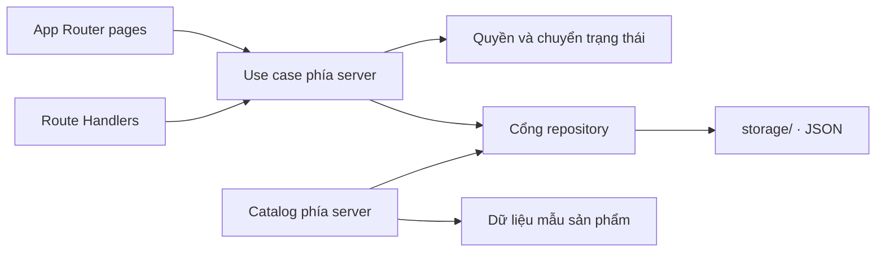

# Architecture Spine · Vận hành đơn hàng

**Paradigm:** Monolith phân lớp theo feature, với use case phía server, domain thuần và repository file JSON. Phạm vi gồm vòng đời đơn, tồn còn bán, phân công giao và các màn hình đọc theo vai trò.

**Căn cứ:** [PRD](../../prds/prd-shoplite-2026-11-21/prd.md), [DESIGN.md](../../ux-designs/ux-shoplite-2026-11-21/DESIGN.md), [EXPERIENCE.md](../../ux-designs/ux-shoplite-2026-11-21/EXPERIENCE.md) và mã nguồn ShopLite. Các quyết định dưới đây áp dụng cho lab nội bộ sử dụng dữ liệu mẫu.

## Quyết định kiến trúc

### AD-1 [ADOPTED] · Biên feature và quy tắc thuần

- **Binds:** Catalog, checkout, orders, các trang và API.
- **Prevents:** Quy tắc nghiệp vụ bị sao chép giữa giao diện và server.
- **Rule:** `src/app` làm lớp chuyển tiếp. Nghiệp vụ nằm trong `src/features/<feature>`. Viết hàm thuần có unit test cho định giá, điều kiện chuyển trạng thái, tính tồn và hạn giao lại. Inject clock và repository vào use case có I/O. Module đọc ghi file chỉ chạy ở server.

### AD-2 [ADOPTED] · Hợp đồng OrderRepository và lưu trữ JSON

- **Binds:** Order service, adapter JSON và adapter in-memory.
- **Prevents:** Use case phụ thuộc trực tiếp vào filesystem hoặc định dạng file.
- **Rule:** Giữ `OrderRepository` làm cổng truy cập. Triển khai tiếp tục dùng file JSON trong `storage/`, mặc định `storage/orders.json`, giữ hỗ trợ `ORDERS_FILE` cho cấu hình và test. Có thể mở rộng interface để biểu diễn một lượt cập nhật nguyên tử. Giữ adapter in-memory tương đương về ngữ nghĩa. Không thêm database hay dịch vụ ngoài.

### AD-3 [ADOPTED] · Validate, lỗi API và snapshot tiền

- **Binds:** Checkout và các lệnh cập nhật đơn.
- **Prevents:** Client tự quyết số tiền hoặc mỗi API trả lỗi theo một định dạng riêng.
- **Rule:** Dùng Zod ở biên server, `OrderError` cho lỗi nghiệp vụ và `handleRouteError` cho envelope hiện tại. Server tính lại giá và phí giao, lưu snapshot tên, ảnh, đơn giá, số lượng và tổng tiền khi tạo đơn. Màn nhân viên và khách đọc giá từ snapshot của đơn. `paymentMethod` hiện chỉ mô tả phương thức. Trạng thái đã thu tiền cần dữ liệu và quy tắc riêng.

### AD-4 [ADOPTED] · Một vòng đời và các lệnh có ý nghĩa nghiệp vụ

- **Binds:** Nhân viên, shipper, khách và các lệnh sửa đơn.
- **Prevents:** Route tự gán status, nhảy bước hoặc làm mất tương thích với đơn cũ.
- **Rule:** Một hàm chuyển trạng thái được chia sẻ trên server. Luồng chính là `pending → confirmed → packed → shipping → delivered`, với nhánh `cancelled`. Map `confirmed` sang **Đang xử lý**, `packed` sang **Đóng gói hoàn tất**, `shipping` sang **Đã gửi đơn**. Khách chỉ tự hủy ở `pending`. Nhân viên có thể hủy trước bàn giao với lý do, hoặc sau bàn giao khi đạt hạn theo AD-11. Phân công shipper trước khi hoàn tất đóng gói. Thao tác ghi kết quả cần xác nhận bàn giao cho đúng lần phân công hiện hành theo AD-10. Đổi người và bàn giao lại giữ `shipping`. Lần giao thất bại cập nhật lịch giao và giữ `shipping`. `delivered` và `cancelled` kết thúc vòng đời. Lệnh nhận lại hàng theo AD-5 giữ `cancelled`. UI dùng chung bảng nhãn và chỉ hiện thời điểm từ sự kiện thực đã lưu.

### AD-5 [ADOPTED] · Một commit cho trạng thái làm thay đổi tồn

- **Binds:** Tạo đơn, tiếp nhận, hủy, nhận lại hàng và đọc tồn.
- **Prevents:** Hai đơn giữ cùng món cuối, mất cập nhật, trừ hoặc hoàn tồn hai lần.
- **Rule:** Một snapshot JSON có version giữ đơn và lượng từng dòng đang giữ hoặc đã tiêu thụ. Tồn còn bán bằng tồn gốc trừ lượng đã giữ hoặc tiêu thụ. Một lần đọc snapshot cung cấp tồn nhất quán cho toàn bộ lệnh. Tạo đơn kiểm tra tồn, giữ hàng phát sinh khi tiếp nhận đủ mọi dòng. Giao thành công chuyển lượng giữ thành đã bán. Hủy trước lần bàn giao đầu tiên giải phóng lượng giữ. Hủy sau lần bàn giao đầu tiên giữ lượng đó đến khi nhận lại, kể cả nếu đang chờ bàn giao lại. Serialize lượt đọc–kiểm tra–ghi theo đích lưu trong một tiến trình, dùng file tạm cùng thư mục và rename để công bố snapshot. Mọi đường ghi, gồm đặt đơn và hủy từ UI cũ, đi chung cơ chế.
- **Rule:** Lệnh nhận lại đối chiếu từng dòng với lượng đang giữ trên snapshot. Mỗi dòng cần đúng sản phẩm, đủ số lượng và xác nhận hàng bán được. Khi mọi dòng đạt, giải phóng lượng giữ trong cùng commit với dấu nhận lại. Hàng thiếu, hỏng hoặc sai mã giữ nguyên tồn của mọi dòng và trả 409 cùng lý do cần đối soát. Lệnh lặp giữ đúng một lần hoàn tồn.
- **Rule:** Phân biệt trạng thái vòng đời với dấu vết bàn giao, lượng đã giữ và lần nhận hàng quay lại trong snapshot. Bản sao có cấu trúc mảng legacy chỉ cho nhân viên đọc để đối soát và từ chối ghi. Chạy ca lab với `ORDERS_FILE` tách biệt và snapshot mới khởi tạo từ tồn danh mục mẫu. Đơn cũ chưa đối soát chưa tham gia phép tính tồn của lab.

### AD-6 [ADOPTED] · Quyền theo người và đơn ngay tại use case

- **Binds:** Server Components, Route Handlers, dữ liệu và lệnh theo vai trò.
- **Prevents:** Lộ thông tin đơn hoặc shipper cũ vẫn cập nhật sau khi đổi phân công.
- **Rule:** Server xác minh danh tính, lọc theo chủ đơn hoặc shipper được giao và kiểm tra lại quyền tại thời điểm commit. Danh sách, chi tiết và lệnh cập nhật dùng chung chính sách. DTO theo vai trò chỉ trả dữ liệu cần thiết. Mã đơn và tham số client không chứng minh quyền sở hữu. `proxy.ts` nếu dùng chỉ xử lý chuyển hướng sớm. Quyền bắt buộc ở lớp use case, gồm cả đường đọc trực tiếp từ Server Components. [Next.js Authentication](https://nextjs.org/docs/app/guides/authentication)

### AD-7 [ADOPTED] · Cùng một nguồn tồn trên các đường đọc

- **Binds:** Trang chủ, danh mục, chi tiết, API sản phẩm, giỏ và checkout.
- **Prevents:** Web hiển thị còn hàng sau khi cửa hàng đã giữ hết.
- **Rule:** Catalog phía server ghép metadata sản phẩm tĩnh với số lượng khả dụng tính từ snapshot. Các đường đọc có hiển thị tồn dùng kết quả mới theo request. Giỏ browser có thể giữ dữ liệu trình bày và phải chấp nhận kết quả kiểm tra cuối của server. Không chia sẻ cache dữ liệu đơn cá nhân giữa phiên. [Next.js Route Handlers](https://nextjs.org/docs/app/getting-started/route-handlers)

### AD-8 [ADOPTED] · Một tiến trình ghi trên ổ bền

- **Binds:** Chạy local, triển khai lab, kiểm thử và khôi phục.
- **Prevents:** Khóa trong bộ nhớ mất hiệu lực giữa nhiều worker hoặc dữ liệu biến mất sau restart.
- **Rule:** Một tiến trình Node.js ghi vào volume cục bộ bền. Dev, test và lab dùng đường dẫn lưu riêng. Chuẩn bị snapshot ban đầu và khôi phục theo AD-11. Kiểm thử repository với cập nhật đồng thời, lỗi ghi và khởi động lại. Kiểm thử phân quyền ở cả trang và API.

### AD-9 [ADOPTED] · Lệnh có revision và biên phản hồi chung

- **Binds:** Route Handlers, UI theo vai trò và repository.
- **Prevents:** Bấm đúp tạo đơn hoặc giữ hàng hai lần, thao tác từ màn cũ ghi đè người vừa cập nhật.
- **Rule:** Checkout tạo phiên chủ và khóa gửi trước yêu cầu tạo đơn đầu tiên, rồi giữ khóa qua các lần gửi lại cùng lần đặt. Khóa tạo đơn theo phiên chủ ghi cùng đơn. Lặp khóa và nội dung trả cùng mã đơn. Đổi nội dung trả 409. Lệnh sửa mới nhận `expectedRevision` và `requestId`. Trong lượt commit, kiểm tra quyền hiện tại trước khi xét yêu cầu đã lưu. Lệnh lặp hợp lệ trả trạng thái đã thực hiện và dữ liệu hiện được phép xem, rồi mới xét revision cho lệnh mới. Khóa yêu cầu lưu theo actor, đơn và loại lệnh cùng định danh và dấu nội dung. Phản hồi và revision thành công chỉ xuất hiện sau khi lưu. Adapter payload hủy cũ kiểm tra quyền và trạng thái mới nhất trong lượt commit.
- **Rule:** Dùng chung envelope `{ error: { code, message, details? } }`. Payload sai trả 400, thiếu phiên trả 401, vai trò sai với chức năng trả 403, đơn không tồn tại hoặc ngoài quyền xem trả 404. Tranh tồn, sai chuyển trạng thái hoặc revision cũ trả 409. UI lấy lại đơn sau 409. Lỗi không đọc hoặc lưu được kho trả lỗi vận hành 503. Nhật ký lỗi lưu mã sự kiện và mã đơn, loại thông tin cá nhân khỏi payload ghi log.
- **Rule:** Khi client hủy đơn và mất phản hồi, chuyển sang trạng thái chờ xác minh và đọc lại đơn qua đường đọc có kiểm tra quyền. Chỉ cho gửi thao tác hủy mới sau khi kết quả đọc xác nhận đơn vẫn còn khả năng hủy. Nếu chưa đọc được, hiển thị lối tải lại đơn và giữ thao tác hủy bị khóa.

### AD-10 [ADOPTED] · Quyền mặc định đóng và ranh giới bàn giao

- **Binds:** Phiên khách, nhân viên, shipper, danh sách và chi tiết.
- **Prevents:** Đường đọc cũ bỏ qua policy hoặc shipper thấy dữ liệu vượt nhu cầu.
- **Rule:** Nhân viên và shipper đăng nhập bằng danh tính cấp sẵn từ cấu hình lab. Dùng bí mật và dữ liệu xác thực từ cấu hình môi trường. Phiên nội bộ tách khỏi phiên khách. Khách nhận định danh ngẫu nhiên do server xác minh trong cookie trước yêu cầu tạo đơn đầu tiên. Cookie dùng `HttpOnly`, `SameSite=Lax` và `Secure` trên HTTPS. Server gắn định danh sở hữu vào đơn và lấy actor từ phiên đã xác minh. Mất phiên khách thì cần liên hệ cửa hàng ngoài lab. Đơn cũ chưa gắn chủ chỉ cấp cho nhân viên có quyền. Trên môi trường dùng chung, kích hoạt tạo đơn có chủ cùng lần phát hành đã bảo vệ trang danh sách, chi tiết và API đọc, hủy cũ. Hai story có thể triển khai trên nhánh lab trước khi phát hành.
- **Rule:** Mỗi lần đổi sang shipper khác tạo một phân công hiện hành mới. Lưu lần bàn giao đầu tiên riêng với xác nhận nhận kiện của phân công hiện hành. Khi đổi sau bàn giao, giữ `shipping` và đưa người mới vào **Chờ bàn giao lại**. Người cũ mất quyền ngay cả với lệnh gửi lại. Người mới chỉ thấy metadata công việc cho tới khi nhân viên xác nhận người đó đã nhận kiện. Cùng lượt commit kiểm tra danh tính, phân công hiện hành, xác nhận bàn giao và revision trước khi cho ghi giao thành công hay thất bại. Thao tác phân công lại cùng người là một lần giữ nguyên dữ liệu. Bàn giao lại lưu sự kiện riêng và giữ nguyên tồn, trạng thái chính cùng mốc bàn giao đầu tiên.

### AD-11 [ADOPTED] · Khôi phục, giao lại và kiểm thử tích hợp

- **Binds:** Vận hành file JSON và xử lý ngoại lệ giao hàng.
- **Prevents:** File lỗi bị coi như kho trống, hủy sớm hoặc hoàn tồn khi hàng chưa quay về.
- **Rule:** Người vận hành dùng bước khởi tạo riêng để tạo snapshot có version trên một đường dẫn lab mới trước khi mở ứng dụng. Chọn đường dẫn mới và xác minh môi trường trước khi chạy bước đó. Khi ứng dụng chạy, kho vắng file, JSON lỗi, version chưa hỗ trợ hoặc lỗi ghi đều trả lỗi vận hành 503 và dừng ghi. Tuyến xử lý request luôn yêu cầu snapshot đã được tạo. Khi khôi phục kho đã chạy, dừng tiến trình ghi, xác minh bản sao tốt gần nhất trước khi thay thế rồi khởi động lại.
- **Rule:** Lưu thời điểm thất bại đầu tiên, các lần thử và lịch hẹn tách khỏi trạng thái đơn. Tính ngày bằng đồng hồ server theo `Asia/Bangkok`. Lịch dự kiến là ngày lịch sau lần thất bại gần nhất. Hủy sau bàn giao cần nhân viên xác nhận từ 00:00 ngày D+3, với D là ngày thất bại đầu tiên. Lưu dấu nhận hàng quay về bằng lệnh riêng. DTO nhân viên và shipper hiện hành có ngày hẹn. DTO khách giữ trạng thái tiến độ chung.
- **Verification:** Chạy kịch bản hai người tiếp nhận món cuối, hủy đồng thời với tiếp nhận, đổi shipper đồng thời với giao thành công, gửi lặp, lỗi lưu giữa chừng và restart. Kiểm tra endpoint và Server Components đều giới hạn chủ đơn. Đảm bảo snapshot legacy tải được và chưa có đủ dữ liệu thì không tự cộng trừ tồn.

### AD-12 [ADOPTED] · Xác nhận thanh toán và điều kiện bàn giao

- **Binds:** Snapshot đơn, nhân viên, bàn giao, kết quả giao và hủy.
- **Prevents:** Suy ra đã thu tiền từ phương thức thanh toán hoặc nhầm cập nhật tồn với hoàn tiền.
- **Rule:** Lưu tình trạng xác nhận tiền riêng với phương thức, kèm người xác nhận và thời điểm. Chủ đơn thấy hướng dẫn và tổng tiền từ snapshot nếu phương thức là chuyển khoản, chưa có xác nhận thu và trạng thái là `pending`, `confirmed` hoặc `packed`. Nhân viên xác nhận chuyển khoản sau đối chiếu trước bàn giao. Với chuyển khoản chưa xác nhận, từ chối bàn giao. Với COD, cho phép bàn giao khi chưa thu, rồi xác nhận thu trong cùng commit giao thành công do shipper hiện hành đã nhận kiện thực hiện. Khi hủy đơn đã xác nhận tiền, giữ bản ghi thu để đối soát ngoài ShopLite. Quyền, revision và lệnh lặp theo AD-6 và AD-9.

## Seed từ package.json

Node.js `>=22.12.0`, Next.js `16.4.2`, React và React DOM `19.3.0`, TypeScript `^5`, Tailwind CSS `^4`, Zod `^4.6.7`, Vitest `^5.0.5`, Playwright `^1.64.1`. Đây là phiên bản khai báo. Workspace chưa có `node_modules/next/dist/docs/`; hành vi framework được đối chiếu với [tài liệu Proxy chính thức](https://nextjs.org/docs/app/api-reference/file-conventions/proxy).

## Deferred

- **Trước triển khai thật:** Cửa hàng và kỹ thuật đối soát tồn đầu kỳ và dữ liệu đơn chưa gắn chủ. Quy trình khôi phục quyền, xoay vòng phiên và nhập kho thật được xem lại lúc đó.
- **Giai đoạn sau:** Phiếu hoàn trả hậu mãi, voucher, tích hợp hãng vận chuyển, hoàn tiền tự động và thông báo qua dịch vụ ngoài.

## Điểm đối chiếu trong repo

- [OrderRepository](../../../../src/features/orders/order-repository.ts) và [order service](../../../../src/features/orders/order-service.ts) xác nhận cổng và lỗi hiện có. `save` hiện đọc–sửa–ghi mảng, nên rename đơn lẻ chưa ngăn mất cập nhật.
- [Kiểu đơn](../../../../src/features/orders/types.ts) có `confirmed` và `shipping`, chưa có mốc đóng gói. [Catalog](../../../../src/features/catalog/catalog-service.ts) đọc tồn từ sản phẩm mẫu.
- [Orders API](../../../../src/app/api/orders/route.ts) và [trang đơn khách](../../../../src/app/orders/page.tsx) hiện gọi danh sách chung. Đây là điểm cần đóng khi triển khai AD-6.
- [Product brief](../../briefs/brief-shoplite-2026-11-21/brief.md) và [HTML mẫu](../../briefs/brief-shoplite-2026-11-21/shoplite-demo.html) là nguồn nghiệp vụ tạm.
